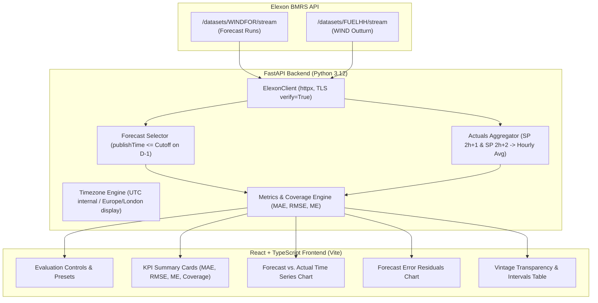

# Wind Forecast Intelligence

A quantitative web application built for a UK energy utility to evaluate national wind generation forecasts against actual outturn generation using the official **Elexon BMRS (Insights Solution) API**.

---

## 1. Project Overview and Scope

The application enables energy analysts to:
1. **Retrieve and Select Eligible Forecasts**: Query national wind generation forecasts (`WINDFOR`) and select the latest eligible forecast vintage published at or before a day-ahead purchasing decision cutoff.
2. **Aggregate Actual Outturn Generation**: Retrieve half-hourly outturn generation (`FUELHH`, filtered strictly to `fuelType = WIND`) and aggregate constituent settlement periods into hourly averages.
3. **Quantitatively Evaluate Accuracy**: Compute Mean Absolute Error (MAE), Root Mean Squared Error (RMSE), Mean Error (ME with explicit directional sign), and data coverage across customizable horizons.
4. **Audit Forecast Vintages**: Inspect the exact publication timestamp of the forecast selected for each delivery interval, guaranteeing strict historical decision cutoff compliance.

> **Scope Boundary**: This application is strictly an evaluation and forecast intelligence dashboard for national wind generation. It does not perform consumer demand forecasting, electricity price forecasting, or automated purchasing recommendations.

---

## 2. Architecture and Data Flow



- **Backend (Python 3.12 / FastAPI)**: Asynchronous HTTP client (`httpx`), timezone-aware timestamp normalization, vintage selection, temporal aggregation, and quantitative metric calculations.
- **Frontend (React 19 / TypeScript / Vite)**: Responsive analytics dashboard with custom interactive SVG charts (Forecast vs. Actual time series with gap handling, Error residual analysis), KPI metric cards, and a paginated vintage audit table.
- **Data Flow**: The frontend queries the FastAPI backend, which retrieves raw records from official public Elexon BMRS streaming endpoints with verified TLS.

---

## 3. Data Methodology and Metric Definitions

### 3.1 Decision Cutoff & Vintage Selection
- **Delivery Date ($D$)**: The calendar date when electricity is generated and physically delivered (e.g., $D \in [2026\text{-}01\text{-}01, 2026\text{-}01\text{-}31]$).
- **Provisional Default Cutoff**: **12:00:00 UTC on day $D - 1$** *(Assessment baseline assumption, configurable via UI/API)*.
- **Selection Criterion**: For each delivery hour $T$ on day $D$, candidate forecasts are filtered strictly by:
  $$\text{publishTime} \le \text{Cutoff}(D) = (D - 1)\text{T}12:00:00\text{Z}$$
  The forecast record maximizing $\text{publishTime}$ is selected.
- **Strict Post-Cutoff Exclusion**: Any forecast run published after the applicable cutoff is ineligible. Post-cutoff forecasts can never influence evaluation.
- **Cross-Year Lookback**: Delivery for 1 January 2026 requires forecasts published on or before 12:00 UTC on 31 December 2025. Data retrieval queries `WINDFOR` starting 48 hours prior to the delivery window.

### 3.2 Temporal Aggregation (Hourly vs. Half-Hourly)
- `FUELHH` provides outturn average MW over 30-minute settlement periods ($SP_1$ to $SP_{48}$).
- `WINDFOR` publishes hourly average forecasts ($H_0$ to $H_{23}$).
- **Aggregation Formula**: For delivery hour $H$, the hourly actual generation is the arithmetic mean of its two constituent half-hour settlement periods:
  $$\text{Actual}_{\text{hour } H} = \frac{\text{Actual}(SP_{2H+1}) + \text{Actual}(SP_{2H+2})}{2}$$
- **Missing Data Handling**: If either constituent half-hour observation is missing or null, the hourly actual is preserved as `None` / `null` (never silently replaced with zero). It is excluded from accuracy metrics and counted against coverage.
- **Zero Generation**: Outturn readings of `0.0 MW` are treated as valid generation observations, not missing data.

### 3.3 Accuracy Metrics & Sign Conventions
- **Error Definition**:
  $$\text{Error}_i = \text{Forecast}_i - \text{Actual}_i = \hat{y}_i - y_i$$
- **Mean Absolute Error (MAE)**:
  $$\text{MAE} = \frac{1}{N} \sum_{i=1}^N |\hat{y}_i - y_i|$$
  Measures average forecast error magnitude in MW without regard to direction.
- **Root Mean Squared Error (RMSE)**:
  $$\text{RMSE} = \sqrt{\frac{1}{N} \sum_{i=1}^N (\hat{y}_i - y_i)^2}$$
  Penalizes larger deviations more heavily than MAE.
- **Mean Error (ME)**:
  $$\text{ME} = \frac{1}{N} \sum_{i=1}^N (\hat{y}_i - y_i)$$
  - **$\text{ME} > 0$ (Positive)**: Systematically **over-forecasting** on average (forecast higher than actual generation).
  - **$\text{ME} < 0$ (Negative)**: Systematically **under-forecasting** on average (forecast lower than actual generation).
- **Data Coverage**:
  $$\text{Coverage (\%)} = \frac{N_{\text{valid pairs}}}{N_{\text{expected}}} \times 100\%$$
  - Full January 2026 horizon: $N_{\text{expected}} = 744 \text{ hours}$ (31 days × 24 hours).
  - Single delivery day: $N_{\text{expected}} = 24 \text{ hours}$.
  - Coverage reflects **data availability**, not accuracy. Only intervals where both forecast and actual are valid contribute to MAE, RMSE, and ME.

---

## 4. Quick Start with Docker

The entire application is containerized and runs with a single command without installing local Python or Node.js dependencies.

### Prerequisites
- **Docker Desktop** (macOS, Windows, or Linux) with Docker Compose v2.

### Launch Application
```bash
docker compose up --build
```

Once started:
- Access the dashboard at: **`http://localhost:8080`**
- The frontend Nginx container reverse-proxies `/api/` calls internally to the FastAPI backend container (`http://backend:8000/api/`).
- Backend health status is displayed via the live header indicator (**"Elexon BMRS Ready"**).

### Essential Container Commands
```bash
# View live logs
docker compose logs -f

# Check container health and status
docker compose ps

# Stop containers
docker compose down
```

---

## 5. Local Development and Testing

Local installation is optional and only required when running without Docker.

### 5.1 Backend Setup
```bash
python3 -m venv .venv
source .venv/bin/activate  # Windows: .venv\Scripts\activate
pip install -r backend/requirements.txt
uvicorn app.main:app --app-dir backend --reload --port 8000
```
Backend API available at: `http://localhost:8000` (OpenAPI Swagger docs at `/docs`).

### 5.2 Frontend Setup
```bash
cd frontend
npm install
npm run dev
```
Frontend development dashboard available at: `http://localhost:5173`.

### 5.3 Automated Tests & Verification
```bash
# 1. Run all backend tests (43 unit & integration tests)
.venv/bin/pytest backend/tests -v

# 2. Run live January 2026 backtest validation script (queries official Elexon endpoints)
.venv/bin/python backend/scripts/validate_january_2026.py

# 3. Run all frontend tests (43 unit & component tests in 7 suites)
cd frontend && npm test

# 4. Verify frontend production TypeScript build
cd frontend && npm run build
```

---

## 6. January 2026 Backtest Results

Executing the pipeline across the complete month of January 2026 with the provisional day-ahead cutoff of **12:00 UTC on day $D - 1$** yields the following reproducible results:

| Metric | Result | Interpretation |
| :--- | :---: | :--- |
| **Expected Hourly Intervals** | **744 hours** | 31 days × 24 hours per day. |
| **Valid Observation Pairs** | **744 hours** | 100% data availability across both `WINDFOR` and `FUELHH`. |
| **Data Coverage** | **100.00%** | Zero missing intervals or gaps in January 2026. |
| **Mean Absolute Error (MAE)** | **2,017.92 MW** | Average magnitude of hourly forecast error. |
| **Root Mean Squared Error (RMSE)** | **2,477.04 MW** | Quadratic deviation metric reflecting error variance. |
| **Mean Error (ME)** | **+1,806.23 MW** | **Net over-forecasting** observed across the day-ahead horizon in January 2026. |

*Sample daily outturns*:
- **1 Jan 2026**: 24/24 pairs, MAE = 4,233.6 MW, RMSE = 4,283.0 MW, ME = +4,233.6 MW (100% coverage)
- **15 Jan 2026**: 24/24 pairs, MAE = 1,173.0 MW, RMSE = 1,281.3 MW, ME = +1,073.4 MW (100% coverage)
- **31 Jan 2026**: 24/24 pairs, MAE = 2,247.7 MW, RMSE = 2,368.2 MW, ME = +2,247.7 MW (100% coverage)

*Note: These figures are empirical historical backtest results demonstrating pipeline correctness; they do not represent universal guarantees for other months or alternative cutoff times.*

---

## 7. Assumptions and Known Limitations

1. **Cutoff Assumption vs. Commercial Policy**:
   - The provisional 12:00 UTC cutoff on day $D - 1$ is an analytical assessment assumption to inspect forecast vintages. It does not represent an established commercial trading rule or gate closure.
2. **Timezone Normalization & Display**:
   - **Internal**: All ingestion, interval matching, filtering, and metric math strictly use timezone-aware UTC (`datetime` with `timezone.utc`).
   - **Presentation**: Timestamps are converted to `Europe/London` exclusively for UI presentation via `Intl.DateTimeFormat`, dynamically showing `GMT` in winter and `BST` in summer.
3. **Publication Timestamps & Documentation Nuance**:
   - Elexon's Data Catalogue lists publication times as `03:30, 05:30, ...`.
   - Live API verification revealed that during winter (GMT / UTC+0), actual UTC publication timestamps in `WINDFOR` records are `02:30Z, 04:30Z, ...` (1 hour earlier in UTC). On the daylight saving transition (29 March 2026), they shift to `03:30Z, 05:30Z, ...`. The application parses the raw UTC string directly without hardcoded clock offsets. Detailed empirical logs are documented in [`docs/elexon-api-investigation.md`](docs/elexon-api-investigation.md).
4. **Daylight Saving Time (DST) & Settlement Mapping**:
   - January 2026 is entirely within Greenwich Mean Time (GMT / UTC+0), where every day has 48 settlement periods.
   - Clock-change days (46 settlement periods in March, 50 in October) require non-standard period-to-hour mappings and are outside the January 2026 assessment scope.
5. **Resolution Reconciliation**:
   - `FUELHH` is half-hourly; `WINDFOR` is hourly. Arithmetic averaging of the two constituent settlement periods preserves dimensional consistency in MW.

---

## 8. Deployment Instructions

### 8.1 Vercel-Only Deployment (Vercel Services & Container Runtime)

The application provides a unified, single-project configuration on **Vercel** using **Vercel Services**:
- **Frontend Service**: Native Vite build rooted in `frontend/`, built as a static Single Page Application and served globally from Vercel's Edge Network with zero cold-start overhead.
- **Backend Service**: Containerized FastAPI service rooted in `backend/`, built from `backend/Dockerfile.vercel` and executed as an autoscaling container function on Vercel Fluid Compute.
- **Unified Routing & Same-Origin APIs**: The root `vercel.json` rewrites `/api/(.*)` to the `backend` service and `/(.*)` to the `frontend` service. All API calls from the browser remain same-origin (`/api/...`), avoiding cross-origin preflight requests and eliminating the need for hardcoded backend URLs.

#### Required Vercel Project & Account Settings
1. **Framework Preset**: Must be set to **Services** in Vercel Project Settings (or detected automatically via root `vercel.json`).
2. **Root Directory**: Must be set to `.` (the repository root), **not** `frontend`.
3. **Plan & Feature Prerequisites**: Vercel Services is currently available in **Beta** across all Vercel plans (Hobby, Pro, Enterprise). Container workloads build via Vercel Container Registry (VCR) and execute on Fluid Compute with a 300-second execution ceiling. Container build access must be enabled for your Vercel team/account.
4. **Port Configuration**: Vercel's container runtime routes traffic to port `80` by default. `backend/Dockerfile.vercel` starts Uvicorn bound to `0.0.0.0:${PORT:-80}`.
5. **Environment Variables (Optional)**:
   - `VITE_API_BASE_URL`: **Leave empty or unset**. Requests default to relative `/api/...` paths on the same origin.
   - `ELEXON_BASE_URL`: `https://data.elexon.co.uk/bmrs/api/v1` (default).
   - `ELEXON_REQUEST_TIMEOUT`: `30.0` (default).
   - `DEFAULT_CUTOFF_TIME`: `12:00:00` (default).

> **Deployment Status**: The Vercel Services configuration (`vercel.json` and `backend/Dockerfile.vercel`) has been verified and tested locally (container builds, tests, and build artifacts pass). Cloud deployment requires connecting the repository to Vercel with the Services preset enabled.

### 8.2 Alternative Decoupled Deployment (Docker PaaS + Vercel SPA)

For hosting environments that do not use Vercel Services:
- **Backend (Render, Railway, or Heroku Container Registry)**:
  1. Build and deploy using `backend/Dockerfile` (listens dynamically on `${PORT:-8000}`).
  2. Set `CORS_ORIGINS` to include your frontend URL (e.g., `https://wind-forecast-intelligence.vercel.app,http://localhost:5173`).
  3. Verify health endpoint: `GET https://<your-backend>/api/health`.
- **Frontend (Vercel Static SPA)**:
  1. Root directory set to `frontend/`.
  2. Set `VITE_API_BASE_URL=https://<your-deployed-backend-url>`.
  3. Deploy using standard Vite preset (`frontend/vercel.json` provides client-side SPA routing).

### 8.3 Local Deployment (Docker Compose)

For local evaluation, use the one-command multi-container Docker Compose workflow detailed in [Section 4](#4-quick-start-with-docker) (`docker compose up --build`). Local Docker Compose remains completely independent, using `backend/Dockerfile` and `frontend/Dockerfile` with Nginx reverse proxying.

---

## 9. AI Tools Disclosure

In accordance with assessment guidelines:
- **Antigravity (Gemini 3.8 Flash)** was utilized as an agentic pair-programming assistant during development, including:
  - Investigating official Elexon OpenAPI specifications and endpoint behavior.
  - Implementing the Python FastAPI backend, Elexon client, cutoff filtering, metric equations, and automated pytest suite.
  - Scaffolding the React + TypeScript frontend, building SVG time-series charts, and writing Vitest component tests.
  - Standardizing timezone-aware date/time formatting with dynamic GMT/BST labels.
  - Multi-stage Dockerfile and Docker Compose containerization.
- All mathematical formulas, API integration logic, and backtest results were verified through independent automated tests and live data validation.
